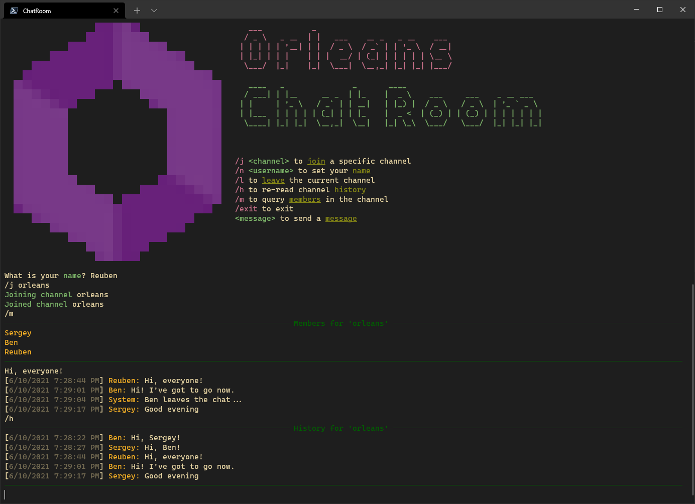

---
languages:
- csharp
- javascript
products:
- dotnet
- dotnet-orleans
- aspnet-core
- signalr
page_type: sample
name: "Orleans Chat Room sample with Web UI"
urlFragment: "orleans-chat-room-sample"
description: "An Orleans sample chat room app with modern web frontend using SignalR."
---

# Orleans Chat Room sample



This sample uses [Orleans Streaming](https://learn.microsoft.com/dotnet/orleans/streaming) to build a real-time chat application. The sample demonstrates:

* **Real-time messaging** using Orleans Streams
* **Channel-based chat** with multiple users
* **Chat history** persistence
* **Modern web UI** with SignalR for real-time updates
* **Console client** for terminal-based interaction

## Features

In this application, each client can:

* Set their nickname
* Join and leave chat channels
* Send and receive messages in real-time
* See who's online in the channel
* View chat history
* Receive system notifications (joins/leaves)

## Architecture

Each chat channel has a corresponding `ChannelGrain` which:
- Is identified by the channel's name
- Manages a stream identified by a `Guid`
- Maintains chat history (last 100 messages)
- Tracks online members

Clients connect to the `ChannelGrain` and subscribe to its stream to receive real-time updates.

## Sample prerequisites

This sample is written in C# and targets .NET 10. It requires the [.NET 10 SDK](https://dotnet.microsoft.com/download/dotnet/10.0) or later.

## Running the sample

### Option 1: Web Frontend (Recommended) 🌐

1. **Start the Orleans Server:**
   ```bash
   cd ChatRoom.Service
   dotnet run
   ```

2. **Start the Web Frontend:**
   ```bash
   cd ChatRoom.Web
   dotnet run
   ```

3. **Open your browser** to `https://localhost:5001` (or the URL shown in console)

4. **Use the chat:**
   - Enter your nickname
   - Enter a channel name (e.g., "general")
   - Click "Join Channel"
   - Start chatting!

### Option 2: Console Client 💻

1. **Start the Orleans Server:**
   ```bash
   cd ChatRoom.Service
   dotnet run
   ```

2. **Start one or more Console Clients:**
   ```bash
   cd ChatRoom.Client
   dotnet run
   ```

The console client provides a text-based interface with interactive commands.

### Using the Quick Start Script

For convenience, you can use the provided scripts:

**Windows (PowerShell):**
```powershell
.\run.cmd
```

**Linux/Mac:**
```bash
./run.sh
```

These scripts will start both the server and a client in separate terminal windows.

## Building in Visual Studio

1. Open `ChatRoom.sln` in Visual Studio 2022 or later
2. Set either `ChatRoom.Web` or `ChatRoom.Client` as the startup project
3. Press <kbd>F5</kbd> to run with debugging, or <kbd>Ctrl</kbd>+<kbd>F5</kbd> to run without debugging

**Note:** The server (`ChatRoom.Service`) must be running before starting any client.

## Project Structure

```
ChatRoom/
├── ChatRoom.Service/       # Orleans silo hosting the grains
├── ChatRoom.Client/        # Console-based chat client
├── ChatRoom.Web/          # Modern web-based chat client (NEW!)
├── ChatRoom.Common/        # Shared interfaces and models
└── ChatRoom.sln           # Solution file
```

## Technologies Used

- **Orleans** - Distributed actor framework
- **Orleans Streaming** - Real-time message streaming
- **ASP.NET Core** - Web framework
- **SignalR** - Real-time web functionality
- **Bootstrap 5** - UI framework
- **Bootstrap Icons** - Icon library
